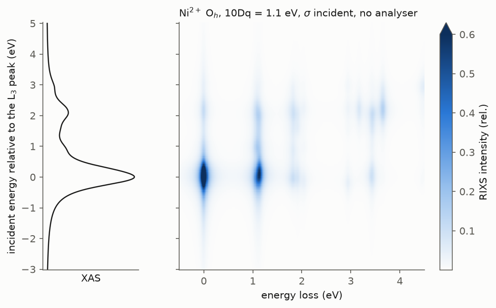
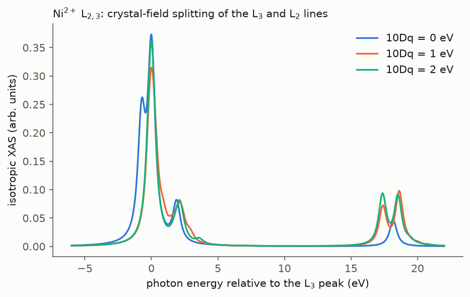
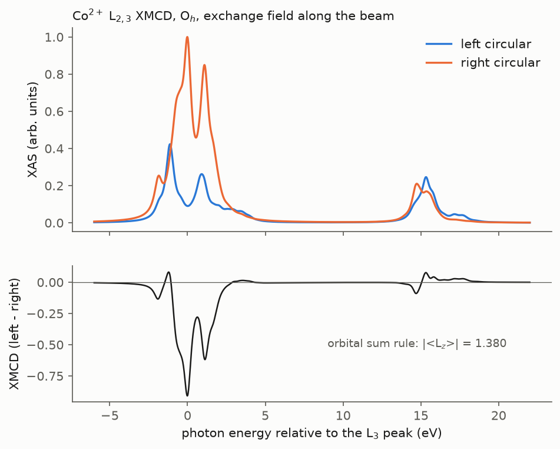
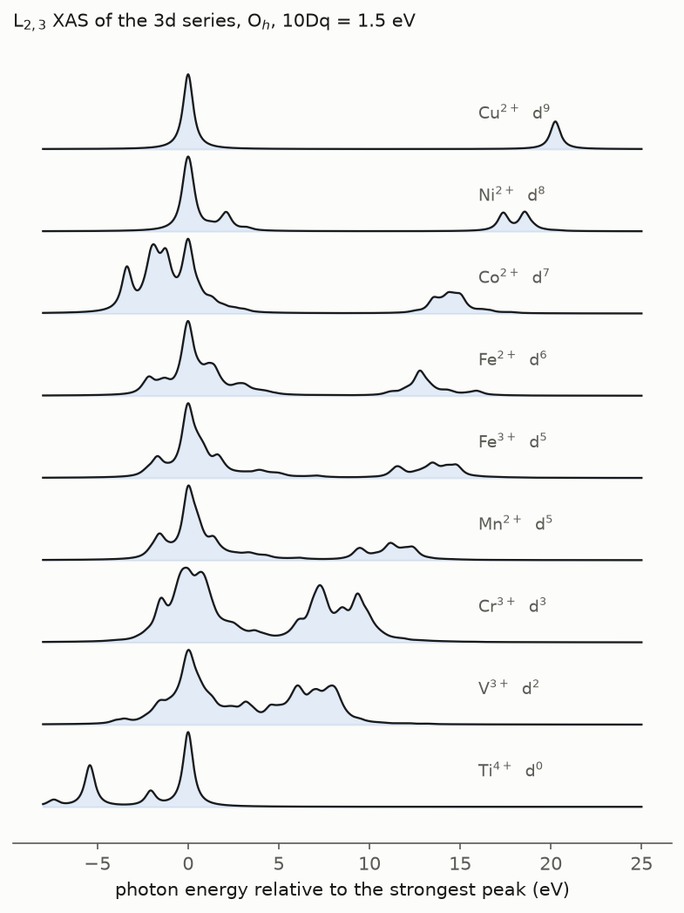
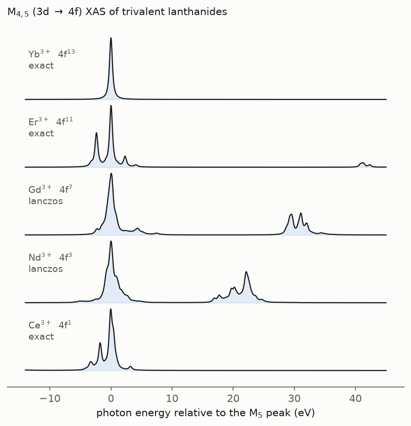
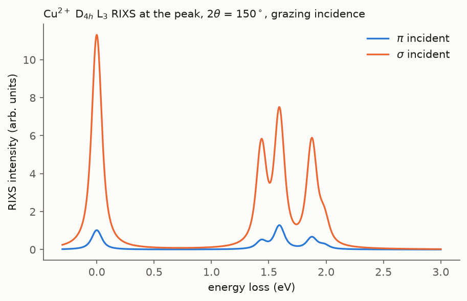

# `xas_rixs` — XAS and RIXS of transition-metal and rare-earth ions, on top of EDRIXS

X-ray absorption (XAS, XMCD, XLD) and resonant inelastic x-ray scattering (RIXS)
spectra in the **single-ion (crystal-field multiplet) model**: the ion, its
Coulomb multiplets, spin–orbit coupling, a crystal field and an exchange or
Zeeman field. It covers the 3d, 4d, 5d, 4f and 5f series at any dipolar edge
(L₂,₃, M₂,₃, M₄,₅, N₄,₅, …) and at the quadrupolar K pre-edge. Atomic
parameters for 50 elements ship with the package.

> **Status.** The single-ion model is complete and validated against EDRIXS
> (see *Validation*). The **Anderson impurity / charge-transfer model is in
> development**; see *Roadmap*.

XPS (L and K core levels) is also in development and will share the same
ion model, so one parameter set will drive every observable.



## Installation

`edrixs` is **not** reliably installable from PyPI, so put it on the path
separately. Only its pure-Python parts are used: no MPI and no Fortran.

```bash
# 1. edrixs, either from conda-forge ...
conda install -c conda-forge edrixs
#    ... or from a checkout on PYTHONPATH
git clone https://github.com/NSLS-II/edrixs
export PYTHONPATH=$PWD/edrixs:$PYTHONPATH

# 2. this package
pip install -e .            # add '[dev]' for pytest + h5py
```

## Quick start

```python
import numpy as np
from xas_rixs import IonModel, solve_ion, xas, rixs

# diagonalise once ...
ion = solve_ion(IonModel(atom='Ni', valence=2, edge='L23', ten_dq=1.1))

# ... then any number of spectra
iso = xas(ion)                                  # isotropic XAS
lh  = xas(ion, pol='LH', thin=np.radians(30))   # linear, 30 deg grazing
mcd = xas(ion, pol='left').intensity - xas(ion, pol='right').intensity  # needs ext_B

r = rixs(ion, ominc=[0.0, 2.1],                 # incident energies on the XAS axis
         eloss=np.linspace(-0.5, 4, 500),
         pol_in='LV', pol_out='unpolarized',
         thin=np.radians(20), thout=np.radians(130),
         gamma_f=0.05, gauss_fwhm=0.03)

iso.omega, iso.intensity, iso.poles             # spectrum and (energy, weight) sticks
r.ominc, r.eloss, r.intensity                   # (n_incident, n_loss) map
r.pole_e, r.pole_w                              # loss of every final state, weight per ominc
r.save(outdir='output')                         # .dat files + _info.json provenance
```

From the shell (angles in degrees):

```bash
xas-rixs xas  --atom Ni --valence 2 --edge L23 --ten_dq 1.1 --plot
xas-rixs xas  --atom Co --valence 2 --ext_B "[0,0,0.01]" --pol left
xas-rixs rixs --atom Cu --valence 2 --edge L3 --cf square_planar --ten_dq 1.6 \
              --cf_ds 0.25 --ominc "[0]" --pol_in LH --thin 20 --thout 130 \
              --eloss=-0.5,3,600 --plot
```

Every field of `IonModel` is exposed as `--field value` (lists and dicts as
JSON), and `--config` reads the same names from a JSON file.

## Physics

**XAS** (Fermi golden rule):

$$ \mu(\omega)=\sum_i p_i\sum_n |\langle n|\boldsymbol\epsilon\cdot\mathbf T|i\rangle|^2\,L_{\Gamma_c}(\omega-E_n+E_i) $$

**RIXS** (Kramers–Heisenberg):

$$ I(\omega_{in},\omega_{loss})=\sum_i p_i\sum_f\Big|\sum_n
\frac{\langle f|(\boldsymbol\epsilon'\cdot\mathbf T)^\dagger|n\rangle\langle n|\boldsymbol\epsilon\cdot\mathbf T|i\rangle}
{\omega_{in}-E_n+E_i+i\Gamma_c}\Big|^2 L_{\Gamma_f}(\omega_{loss}-E_f+E_i) $$

* $|i\rangle$, $|f\rangle$: eigenstates of the initial Hamiltonian $v^n$ (valence
  Coulomb, valence SOC, crystal field, field), with Boltzmann weights $p_i$.
* $|n\rangle$: eigenstates of the intermediate Hamiltonian $v^{n+1}\underline{c}$,
  which adds the core SOC and the core–valence multipoles $F^k_{dc}$, $G^k_{dc}$.
* $\mathbf T$: the EDRIXS transition operators. They are dipolar when the
  valence and core $\ell$ differ by one, and quadrupolar for the K pre-edge
  (1s→3d). Absolute intensities are on the EDRIXS scale and comparable
  between polarisations, geometries and edges of one ion.

The intermediate-state parameters are those of $v^{n+1}\underline{c}$ (e.g.
`3d9_2p5` for Ni²⁺), not of the XPS final state $v^{n}\underline{c}$.

## The model parameters

**Ion and edge**: `atom`, `valence` (or `nd`), `shell`, and `edge`. The edge
is a whole core shell (`L23`, `M45`, `M23`, `N45`, `K`, …) or a spin–orbit
sub-shell (`L3`, `L2`, `M5`, `M4`). A sub-shell gives a smaller intermediate
space but neglects L₃–L₂ mixing. `available_edges(atom)` lists what is
tabulated.

**Coulomb**: `scale_dd`, `scale_dc` (default 0.8 of Hartree–Fock),
`slater_override` (both states) and `slater_override_n` (intermediate state
only), by name (`F2_dd`, `G1_dc`, …). `U_dd`/`U_dc` only shift the edge
rigidly in a single-ion model.

**Spin–orbit**: `scale_soc_v`, `scale_soc_c`, or explicit `soc_v_i`, `soc_v_n`,
`soc_c`.

**Crystal field**: `cf='auto'|'cubic'|'tetragonal'|'square_planar'|'matrix'|'none'`
with `ten_dq`, `cf_d1`, `cf_d3`, `cf_ds`, or `cf_matrix` (real harmonics). Use
`ten_dq_n` if the core hole changes it. `'auto'` is cubic for d shells and none
for f shells. For f-shell crystal fields, pass `cf_matrix`.

**Field and orientation**: `ext_B` (eV) acting on `on_which='spin'|'orbital'|'both'`.
`local_axis` gives the crystal axes in the frame of the scattering geometry.

**Temperature**: `temperature`, `p_tol`, or `n_gs` to fix the number of
initial states averaged over.

**Energy axis**: The model predicts relative energies only. `reference` picks
the zero: `'peak'` (strongest isotropic XAS feature, default), `'centroid'`,
`'first_pole'`, `'edge'` (strongest feature at the tabulated edge energy,
e.g. 852.7 eV for Ni L₃) or `'raw'`. `shift` then moves the axis. XAS and
the RIXS incident energies share this axis. `gamma_c` (default: tabulated
lifetime) sets the width used to find the peak and the default spectral
width.

**Polarisation and geometry** (EDRIXS conventions): `thin`/`thout` are measured
from the sample surface, so the scattering angle is `thin + thout`; `phi` is the
azimuth. A polarisation is `'LH'`/`'pi'`, `'LV'`/`'sigma'`, `'left'`, `'right'`,
`('linear', alpha)`, `'isotropic'` (average over orientations), `'unpolarized'`
(π and σ averaged on the way in, summed on the way out, i.e. no analyser), or
an explicit complex 3-vector.

## Solvers and cost

The initial Hamiltonian is always diagonalised fully (at most 3 432 states, for
4f⁷). The intermediate Hamiltonian is diagonalised fully up to `max_dense`
(6 000) states. Above that, `method='lanczos'` builds, for each initial state
and incident polarisation, a fully reorthogonalised Krylov space from
$\boldsymbol\epsilon\cdot\mathbf T|i\rangle$ (`n_kryl`, default 400). Its Ritz
states then serve as the intermediate states. XAS from them is identical to
the continued fraction; RIXS uses them in Kramers–Heisenberg, so both spectra
come out of one code path.

Measured on one laptop:

| ion, edge | initial | intermediate | solve | XAS | RIXS, 2 incident energies |
|---|---|---|---|---|---|
| Ni²⁺ L₂,₃ | 45 | 60 | 0.1 s | ms | ms |
| Fe³⁺ L₂,₃ | 252 | 1 260 | 1.2 s | 0.1 s | 0.02 s |
| Gd³⁺ M₄,₅ (Lanczos) | 3 432 | 30 030 | 15 s | 0.05 s | 80 s, ~3 GB |

## Examples

```bash
python examples/xas_rixs_examples.py all     # or a number; no argument lists them
```

| | |
|---|---|
|  |  |
| Ni²⁺ L₂,₃ vs 10Dq | Co²⁺ XMCD and the orbital sum rule |
|  |  |
| the 3d series | lanthanide M₄,₅ (Yb³⁺ has no M₄, as it should) |
|  |  |
| Cu²⁺ D₄ₕ d–d excitations, π vs σ | Ni²⁺ RIXS map |

For generating labelled single-ion datasets (many sampled parameter sets,
L and K edges), see [docs/single_ion_workflow.md](docs/single_ion_workflow.md).

## Validation

`pytest`: 12 tests, about 20 s.

* **Against EDRIXS's own solvers** (`ed_1v1c_py`, `xas_1v1c_py`,
  `rixs_1v1c_py`), with Ni²⁺ L₂,₃ in a field with a rotated crystal, Cu²⁺ L₃
  (sub-shell), Ni²⁺ K (quadrupolar, rotated scattering frame) and Ce³⁺ M₄,₅
  (f shell). Eigenvalues agree to 1e-9, XAS in linear, circular and isotropic
  polarisation to ~1e-13, and RIXS for several polarisation pairs to ~1e-14.
* **The sparse many-body layer** (Fock spaces, two-/four-fermion and transition
  operators) is pinned against EDRIXS's dense builders.
* **Lanczos vs exact**: exact (1e-14) when the Krylov space spans the
  intermediate space. For Fe³⁺ with 300 of 1 260 states, XAS agrees to 4e-8
  and RIXS to 3e-7.
* **Sum rules**: isotropic XAS weight is exactly 1/3 per valence hole for
  every 3d ion and for 4f ions at M₄,₅. With core–valence multipoles and
  valence SOC switched off, L₃:L₂ is exactly 2:1. The **XMCD orbital sum
  rule** $|\int(\mu_+-\mu_-)|/\int(\mu_++\mu_-+\mu_0)=|\langle L_z\rangle|/2n_h$
  holds to 1e-10 for Fe²⁺, Co²⁺ and Ni²⁺.
* **Symmetry**: no linear dichroism in O_h or within the D₄ₕ plane; isotropic
  XAS is independent of `local_axis`; a d⁰ ion scatters only elastically.
* **Parameters**: the intermediate-state Slater integrals match
  `edrixs.get_atom_data`. Every tabulated ion has its exact $v^{n+1}\underline c$
  configuration at every edge, with one exception: the quadrupolar d→d edges
  of the 4d/5d metals at the top occupancy, which fall back to a neighbour
  with a warning.

## Repository layout

```
src/xas_rixs/
    model.py         IonModel, build_hamiltonians, transition operators
    solver.py        solve_ion -> IonSolution (exact or Lanczos/Ritz)
    spectra.py       xas, rixs, results, save_result, plotting helpers
    polarization.py  polarisation specs and scattering geometry
    atomic.py        Slater/SOC/edge tables, available_atoms/edges
    fock.py          sparse Fock spaces and many-body operators
    lineshape.py     Voigt broadening, Lanczos, continued fraction
    cli.py           the xas-rixs command
    atom_data/       Slater integrals, SOC, edge energies, core-hole widths (50 elements)
tests/test_xas_rixs.py
examples/xas_rixs_examples.py
tools/make_atom_data.py   rebuilds atom_data/ from the upstream tabulations
docs/figures/
```

## Roadmap

* **Anderson impurity / charge-transfer model (in development).** It adds
  ligand shells hybridising with the metal, giving charge-transfer satellites
  in XAS and charge-transfer excitations in RIXS. The Fock layer already uses
  the `[impurity | bath | core]` orbital order it needs, and `IonModel.nbath`
  is reserved. Setting `nbath > 0` currently raises `NotImplementedError`.
* f-shell crystal fields from Stevens/Wybourne parameters (today: `cf_matrix`).
* Momentum dependence for clusters beyond a single ion.

## The atomic parameter tables

`src/xas_rixs/atom_data/<El>.json` comes from three upstream tabulations, none
redistributed in its original form:

| quantity | source |
|---|---|
| Slater integrals, SOC | [Crispy](https://github.com/mretegan/crispy) (MIT), Cowan RCN/RCG Hartree–Fock |
| edge energies | Elam, Ravel & Sieber, *Radiat. Phys. Chem.* **63**, 121 (2002), via [XrayDB](https://github.com/xraypy/XrayDB) |
| core-hole widths | Keski-Rahkonen & Krause, *At. Data Nucl. Data Tables* **14**, 139 (1974), via XrayDB |

`python tools/make_atom_data.py` rebuilds them (needs `h5py` and network
access, or `--offline` with a cache). The EDRIXS atom data is the second
source (`param_source='edrixs'`); its edge energies and widths take
precedence where it has them.

## Citing

The many-body engine is [EDRIXS](https://github.com/NSLS-II/edrixs)
(Wang *et al.*, *Comput. Phys. Commun.* **243**, 151 (2019)). Please cite it
alongside any result from this package, and credit Crispy and the Elam and
Keski-Rahkonen & Krause tables when using the built-in parameters.

## License

MIT; see `LICENSE`.
